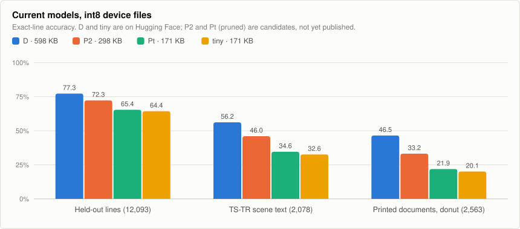
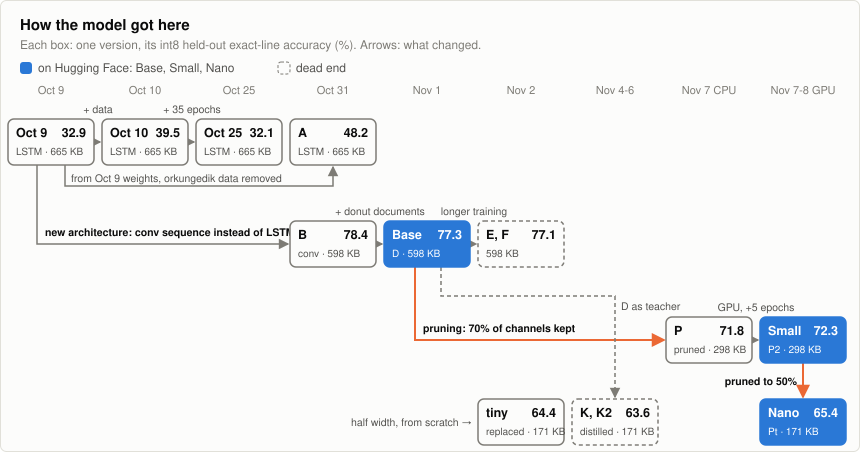
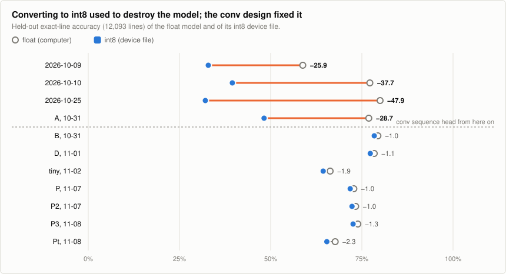
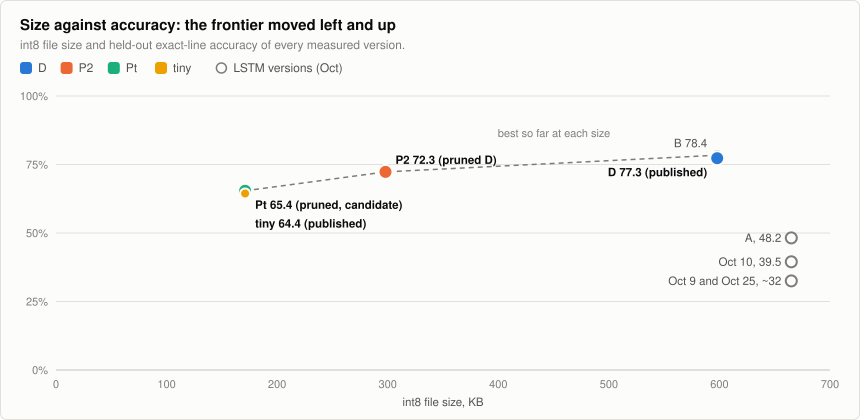
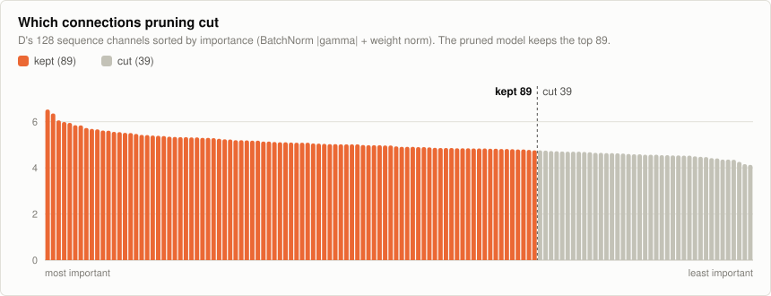
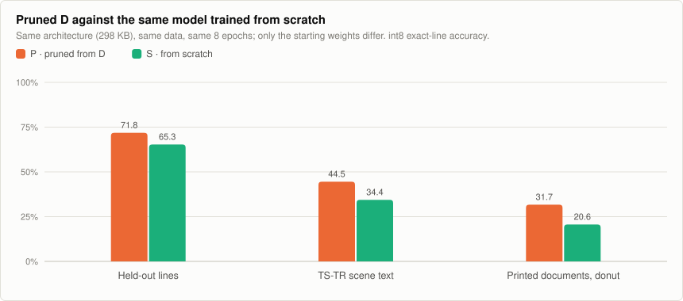
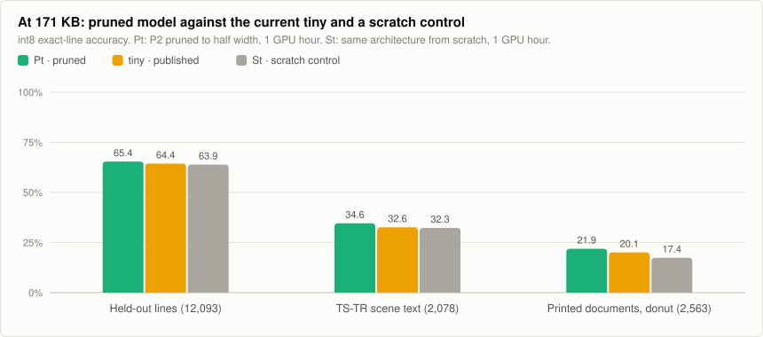
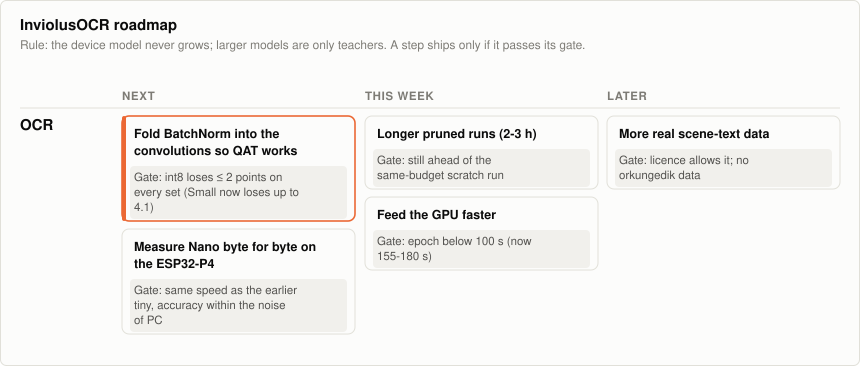

# InviolusOCR: tiny Turkish OCR for microcontrollers

**Türkçe:** Mikrodenetleyiciler için küçük Türkçe OCR modeli. Tek satır basılı
Türkçe metni okur. Üç boyutta yayında: Base (598 KB), Small (298 KB) ve Nano
(171 KB). Small ve Nano, Base'den kanal budanarak elde edildi; Nano, eski 171
KB'lık tiny'nin yerini aldı. Grafikler, sürüm geçmişi ve yol haritası aşağıda.

*Keywords: Turkish OCR, Türkçe OCR, tiny OCR, text recognition, CTC, TFLite,
int8, TinyML, ESP32, microcontroller.*

**InviolusOCR** is a compact, full-int8 CNN-CTC recognizer for a single
horizontal line of printed Turkish text, sized to run on a
microcontroller-class embedded target. It started as part of the
[makeshift-flipper](https://github.com/ErdemWilkinson/makeshift-flipper)
project and was split out because it is a separate concern (a Python and
TensorFlow training pipeline, not ESP-IDF firmware) with its own, much larger
dataset.

**Status:** the training pipeline works end to end. Speed, memory and output on
real input are measured on an ESP32-P4 board. It is not integrated into any
firmware yet.

| Model | Params | int8 file | Held-out | TS-TR | Donut | ESP32-P4, one line |
|---|---:|---:|---:|---:|---:|---:|
| **InviolusOCR-Base** | 560,954 | 598 KB | **77.3%** | **56.2%** | **46.5%** | 1404 ms |
| **InviolusOCR-Small** | 274,450 | 298 KB | 72.3% | 46.0% | 33.2% | 760 ms |
| **InviolusOCR-Nano** | 144,330 | 171 KB | 65.4% | 34.6% | 21.9% | about 420 ms |

All three are on [Hugging Face](https://huggingface.co/inviolus/InviolusOCR)
since 2026-11-08 (int8 `.tflite` for devices, float `.h5`). Nano replaced the
earlier 171 KB `tiny` (64.4% / 32.6% / 20.1%), which it beats on all three
test sets. **Run names used below:** D = Base, P2 = Small, Pt = Nano.

Scores are the share of lines read exactly right by the int8 file. See
[Where the model stands](#where-the-model-stands) for the test sets,
[How it got here](#how-it-got-here) for every version, and
[Roadmap](#roadmap) for what comes next.

## Where the model stands

<picture>
  <source media="(prefers-color-scheme: dark)" srcset="docs/ocr-models-dark.svg">
  
</picture>

All models are scored by `scripts/benchmark.py` on the same rows:

- **Held-out lines:** 12,093 lines from the training sources (synthetic,
  Zenodo, TS-TR, esengul3, STS-TR) that no model trained on. 95% noise margin
  about ±0.9 points.
- **TS-TR scene text:** the official TS-TR test split, 2,078 real photos of
  signs and shop fronts, never trained on. Noise margin about ±2.0 points.
- **Donut:** 2,563 printed-document rows (dates, amounts, headings) from the
  donut 200k test list.

Character error rate of the int8 files:

| Model | Held-out | TS-TR | Donut |
|---|---:|---:|---:|
| Base | 10.0% | 18.8% | 12.6% |
| Small | 11.8% | 23.9% | 18.1% |
| Nano | 14.1% | 31.4% | 24.7% |
| tiny (replaced) | 14.1% | 31.3% | 24.1% |

What this means:

- **Clean printed lines work.** Base reads about three in four held-out lines
  exactly; most errors are one wrong character.
- **Real scene text is the weak spot.** Even Base reads only 56% of TS-TR photos
  exactly.
- **Smaller costs accuracy, but not evenly.** Small keeps 94% of Base's
  held-out score at half the size, Nano 85% at 29% of the size.
- **Nano reads more whole lines than the old tiny, not fewer wrong characters.** Its
  exact-line scores are higher on all three sets (see below), but its
  character error rate is the same as tiny's.
- **None of them meets the acceptance targets yet** (CER ≤ 5%, exact ≥ 80%;
  see [Acceptance targets](#acceptance-targets)).

## How it got here

<picture>
  <source media="(prefers-color-scheme: dark)" srcset="docs/ocr-lineage-dark.svg">
  
</picture>

The biggest step was a change of architecture, not more training. The October
models used a BiLSTM and read up to 80% of held-out lines on a computer, but
lost 26 to 48 points when converted to the int8 file a device runs. Replacing
the BiLSTM with residual dilated 1-D convolutions (model B) cut that loss to
about 1 point:

<picture>
  <source media="(prefers-color-scheme: dark)" srcset="docs/ocr-int8-gap-dark.svg">
  
</picture>

The goal is the smallest Turkish OCR that still works, so what counts is the
best accuracy at each file size. Every current model is both smaller and more
accurate than every October model:

<picture>
  <source media="(prefers-color-scheme: dark)" srcset="docs/ocr-size-frontier-dark.svg">
  
</picture>

### Version history

All rows use the same test rows. Earlier write-ups of each run, with their own
and no longer comparable test sets, were removed from this README to avoid
confusion; they are in the git history up to commit `d210a8b`.

| Version | Date | What changed | Params | int8 | Held-out | TS-TR | Donut | Status |
|---|---|---|---:|---:|---:|---:|---:|---|
| LSTM | 2026-10-09 | TS-TR scene text added | 631,226 | 665 KB | 32.9% | 33.5% | n/m | was on Hugging Face as `erdem-ocr-tr-tinyml`, replaced |
| LSTM | 2026-10-10 | augmentation, 82,814 word crops | 631,226 | 665 KB | 39.5% | 42.7% | n/m | never published (orkungedik data, no licence) |
| LSTM | 2026-10-25 | 35 more epochs | 631,226 | 665 KB | 32.1% | 48.7% | 6.7% | never published (same reason) |
| A, LSTM | 2026-10-31 | from 10-09 weights, orkungedik removed | 631,226 | 665 KB | 48.2% | 41.6% | n/m | replaced by B |
| B, conv | 2026-10-31 | conv sequence head instead of LSTM | 560,954 | 598 KB | 78.4% | 58.2% | 9.3% | replaced by D |
| **D, conv** | 2026-11-01 | B + 47,613 donut document lines | 560,954 | 598 KB | 77.3% | 56.2% | 46.5% | **on Hugging Face as Base** |
| E, F | 2026-11-02 | D trained 5 more hours | 560,954 | 598 KB | 77.1% | 55.5–56.0% | 45.9–46.5% | dead end |
| tiny | 2026-11-02 | half width, from scratch | 144,330 | 171 KB | 64.4% | 32.6% | 20.1% | was on Hugging Face, replaced by Nano |
| K, K2 | 2026-11-04/06 | tiny distilled from D as teacher | 144,330 | 171 KB | 62.4–63.6% | 31.4–32.7% | n/m | dead end |
| P | 2026-11-07 | D pruned to 70% width, 8 epochs | 274,450 | 298 KB | 71.8% | 44.5% | 31.7% | replaced by P2 |
| S | 2026-11-07 | P's architecture from scratch (control) | 274,450 | 298 KB | 65.3% | 34.4% | 20.6% | control only |
| **P2** | 2026-11-07 | P + 5 epochs on a GPU | 274,450 | 298 KB | 72.3% | 46.0% | 33.2% | **on Hugging Face as Small** |
| P3 | 2026-11-08 | D pruned to 70% width again, 1 GPU hour (~23 epochs) | 274,450 | 298 KB | 72.6% | 45.3% | 34.2% | same level as P2 |
| S3 | 2026-11-08 | P3's architecture from scratch, 1 GPU hour (control) | 274,450 | 298 KB | 70.3% | 42.4% | 29.5% | control only |
| **Pt** | 2026-11-08 | P2 pruned to 50% width, 1 GPU hour | 144,330 | 171 KB | 65.4% | 34.6% | 21.9% | **on Hugging Face as Nano** |
| St | 2026-11-08 | Pt's architecture from scratch, 1 GPU hour (control) | 144,330 | 171 KB | 63.9% | 32.3% | 17.4% | control only |

n/m: not measured.

What worked and what did not:

- **Worked:** real scene text (TS-TR) in training; the conv sequence head;
  the donut document lines (printed documents from 9% to 46%); pruning.
- **Did not work:** more epochs of the same training (10-25 over 10-10, E and
  F over D); distilling D into tiny (K, K2 scored below tiny trained alone).

### Pruning: cutting channels out of a trained model

Does cutting channels out of a trained model give a better small model than
training that small model from scratch? Liu et al. (2019, "Rethinking the
Value of Network Pruning") found that often it does not, so this run has a
control.

- **P:** `scripts/prune.py` builds the `OCR_WIDTH=0.7` model and fills it
  with the channels of D that have the largest BatchNorm |gamma| (the Network
  Slimming rule). The four residual Conv1D blocks share one channel stream, so
  their channels are chosen together. Right after the cut the model reads
  0.1% of TS-TR lines, so the fine-tuning does the work, not the cut alone.
- **S:** the same architecture from random weights.

<picture>
  <source media="(prefers-color-scheme: dark)" srcset="docs/ocr-pruning-channels-dark.svg">
  
</picture>

The scores are close together (6.5 at the top, 4.1 at the bottom): D had no idle channels,
every one did some work. That is why the model fails right after the cut and needs fine-tuning.

- Both: the same data and validation rows as D, learning rate 1e-3 with
  cosine decay, augmentation, 7 hours each on a CPU. That was only 8 epochs.

<picture>
  <source media="(prefers-color-scheme: dark)" srcset="docs/ocr-prune-vs-scratch-dark.svg">
  
</picture>

- **Short run (8 epochs, CPU):** pruning won by 6.5 points on held-out
  lines, 10.1 on TS-TR and 11.1 on donut.
- **Long run (1 hour, ~23 epochs, GPU, 2026-11-08):** pruning still wins, but
  the gap shrinks to 2.3, 2.9 and 4.7 points, as Liu et al. predict: the model
  trained from scratch catches up with time, but not fully in this budget.
- **P2** is P trained 5 more epochs on a GPU: +0.5, +1.5 and +1.5 points.
  P3, a fresh prune of D trained for one GPU hour, lands at the same level.
- **int8 loss of P2:** 1.0 point on held-out, 2.7 on TS-TR, 4.1 on donut.

#### Pruning down to tiny's size (171 KB)

**Pt** is P2 pruned once more, from 70% to 50% width, giving exactly tiny's
architecture, then trained for one GPU hour. **St** is the same architecture
from scratch with the same hour, as a control.

<picture>
  <source media="(prefers-color-scheme: dark)" srcset="docs/ocr-prune-tiny-dark.svg">
  
</picture>

Two accuracies side by side ignore that both models read the same lines, so
these comparisons use a paired test (exact McNemar, `scripts/paired_test.py`):
it counts the lines only one of the two models gets right.

| Comparison | Test set | Exact lines, A | Exact lines, B | Only A right | Only B right | p |
|---|---|---:|---:|---:|---:|---:|
| Pt vs tiny | Held-out | 65.4% | 64.4% | 643 | 529 | 0.001 |
| Pt vs tiny | TS-TR | 34.6% | 32.6% | 167 | 125 | 0.016 |
| Pt vs tiny | Donut | 21.9% | 20.1% | 169 | 124 | 0.010 |
| Pt vs St | Held-out | 65.4% | 63.9% | 685 | 504 | < 0.001 |
| Pt vs St | TS-TR | 34.6% | 32.3% | 161 | 113 | 0.004 |
| Pt vs St | Donut | 21.9% | 17.4% | 218 | 103 | < 0.001 |
| P3 vs S3 | Held-out | 72.6% | 70.3% | 582 | 307 | < 0.001 |
| P3 vs S3 | TS-TR | 45.3% | 42.4% | 169 | 109 | < 0.001 |
| P3 vs S3 | Donut | 34.2% | 29.5% | 258 | 138 | < 0.001 |

- **Pt (now Nano) beats the earlier tiny on all three sets**, at the same size and
  architecture, after one GPU hour (tiny had 260 CPU minutes).
- **Pruning is the reason:** the same hour from scratch (St) lands at tiny's
  level, and Pt beats it clearly.
- **The gain is in whole lines, not characters:** Pt's character error rate
  equals tiny's (14.1% held-out). It gets more lines entirely right.

Results: `artifacts/prune-2026-11-07/` and `artifacts/night-2026-11-08/`
(`benchmark_*.json`, `paired_*.json`).

## Roadmap

<picture>
  <source media="(prefers-color-scheme: dark)" srcset="docs/roadmap-ocr-dark.svg">
  
</picture>

Rule for every step: **the device model does not grow.** 598 KB is the
largest file; larger models are only allowed as teachers during training.
A step ships only if it passes its gate.

| Step | Why | Gate to ship | Status |
|---|---|---|---|
| Train pruned and scratch models longer on the GPU | Does pruning still win with a long budget? | Pruned ahead by ≥ 2 points on TS-TR | **passed** 2026-11-08: +2.9 (P3 vs S3, p < 0.001) |
| Prune to tiny's size (width 0.5) | The current tiny was trained from scratch | At 171 KB: held-out > 64.4% and TS-TR > 32.6% | **passed** 2026-11-08: Pt 65.4% / 34.6%, paired test p ≤ 0.016 |
| Publish Pt in place of tiny, and a 298 KB model | Better at the same size; fill the gap between tiny and D | The gates above, plus the ESP32-P4 check | **done** 2026-11-08: published as Nano and Small |
| Measure Nano byte for byte on the ESP32-P4 | Its speed is taken from the earlier tiny (same architecture) | Same speed as tiny, accuracy within the noise of the PC | open |
| Quantization-aware training for the pruned model | P2 loses 4.1 points on donut when converted to int8 | float-to-int8 loss ≤ 2 points on every set | **blocked:** TF-MOT cannot quantize the BatchNorm after Conv1D; needs BN folding or a custom QuantizeConfig |
| Feed the GPU faster | The GPU is only about 30% busy | Epoch time below 100 s (now 155-180 s) | open; uint8 images inside tf.data did not help (180 s), so the input is not the bottleneck |
| More real scene-text data | TS-TR is the weakest set | The licence allows it; no orkungedik data | open |

Not planned again: longer training of the same model, and distilling D into
tiny (see the version history).

Training moved from the CPU to a laptop GPU on 2026-11-07 (WSL2, Ubuntu
22.04, TensorFlow 2.15.1, RTX 4050 6 GB). One epoch of the 298 KB model takes
155 to 180 s on the GPU against 46 to 59 minutes on the CPU, so each step
above is a matter of hours.

## Why a custom model instead of an existing OCR package

This was a deliberate choice, made before any training code was written;
see [DECISION_NOTES.md](DECISION_NOTES.md) for the full reasoning. Short
version: PaddleOCR/PP-OCR and similar general OCR stacks assume a phone or
a real application processor, not a memory-constrained MCU; Tesseract isn't
a TinyML model at all; and per-character classification breaks on kerning,
accents, and variable spacing. A small grayscale CNN + CTC sequence
recognizer for one pre-cropped text line is the smallest model that still
handles variable-length Turkish text correctly.

## Model

- **Input:** `160 x 32 x 1` grayscale image (one cropped, mostly horizontal
  text line), scaled to `[-1, 1]`.
- **Architecture** (`OCR_ARCH=conv` in `scripts/train.py`): 4 conv +
  batch-norm + pool blocks, a dense projection, four residual dilated 1-D
  convolutions (dilation 1, 2, 4, 1), and a dense softmax over the character
  set. `OCR_WIDTH` scales every layer (Base: 1.0, Small: 0.7, Nano: 0.5). The older
  BiLSTM head is still available as `OCR_ARCH=lstm`, which is the default.
- **Output:** per-timestep character logits (40 timesteps, `IMAGE_WIDTH // 4`),
  including a CTC blank class.
- **Character set** (`ALPHABET` in `scripts/train.py`): digits, ASCII
  upper/lowercase, the Turkish letters `ç ğ ı İ ö ş ü Ç Ğ Ö Ş Ü`, a space,
  and `.,:;!?-_/()'%`. Max decoded text length: 24 characters.
- **Decoder:** greedy CTC (argmax per timestep, collapse repeats and blanks),
  deliberately no beam search, to keep post-processing trivial on-device.
- **Quantization:** full int8 (weights, activations, input, output) via
  `scripts/export_tflite.py`.
- **Not included:** text line detection and cropping. Classical
  preprocessing (thresholding, morphology, connected components) is expected
  to produce the line crop before this model runs; see `DECISION_NOTES.md` §4.

## Repository layout

```text
ocr/
├── scripts/
│   ├── generate_synthetic.py      # builds data/lines/synthetic/ + labels.csv rows
│   ├── prepare_real_lines.py      # crops real document photos into labeled lines
│   ├── prepare_code_real_lines.py # line crops for code-style text
│   ├── import_zenodo_dataset.py   # Zenodo printed lines -> data/zenodo_lines/
│   ├── import_tstr_dataset.py     # TS-TR scene-text crops -> data/tstr_lines/
│   ├── prepare_donut.py           # donut 200k document lines -> donut manifest
│   ├── prepare_plates_test.py     # licence-plate test crops (evaluation only)
│   ├── train.py                   # trains the model, writes artifacts/
│   ├── prune.py                   # structured channel pruning of a trained model
│   ├── evaluate.py                # CER + exact-line accuracy on held-out groups
│   ├── benchmark.py               # scores models, float and int8, on the shared test rows
│   ├── make_representative.py     # rebuilds the int8 calibration sample set
│   ├── export_tflite.py           # float .keras -> full-int8 .tflite
│   ├── evaluate_tflite.py         # scores the exported .tflite on the held-out split
│   ├── make_readme_charts.py      # draws the charts in docs/ (uses svgkit.py)
│   └── gradio_demo.py             # local demo UI for trying the model on an image
├── benchmarks/esp32-p4/           # ESP-IDF firmware used for the on-device measurement
├── data/
│   ├── wordlists/tr_50k.txt       # tracked: small (~700KB) input corpus
│   └── ...                        # NOT tracked: generated/imported images and manifests
├── artifacts/
│   ├── alphabet.json              # tracked: the character set, hand-decided
│   ├── night-*/, prune-*/         # tracked: benchmark JSON of each run
│   └── *.keras, *.tflite, *.npy   # NOT tracked: trained model outputs
├── docs/                          # tracked: the charts in this README
├── DECISION_NOTES.md              # the model-selection writeup
├── MODEL_LICENSE.md               # terms for trained models (separate from the MIT code license)
└── requirements-train.txt
```

Only code, the wordlist corpus, the alphabet, benchmark results and charts
are tracked. All data and trained models are gitignored; trained models are
published on Hugging Face instead.

## Dataset layout

```text
ocr/data/lines/<split>/<id>.png
ocr/data/labels.csv
```

`labels.csv` columns: `image,text,group`.

```csv
image,text,group
lines/train/000001.png,İstanbul,generated_font_01
lines/train/000002.png,şifre 123,phone_photo_01
```

`group` drives the train/validation split (`GroupShuffleSplit` in
`train.py`, 15% held out): images from the same font/background/source
group must never appear in both splits, or validation numbers become
optimistic. `train.py` rejects any row whose text is empty, over 24
characters, or contains a character outside `ALPHABET`.

### Building the dataset

Each source has its own manifest; `OCR_LABELS_CSV` combines them.

1. **Synthetic** (`scripts/generate_synthetic.py`): renders 18,000 lines
   from `data/wordlists/tr_50k.txt` with randomized fonts, backgrounds, blur
   and perspective (fixed seed). Writes `data/labels.csv`.
2. **Real photos** (`scripts/prepare_real_lines.py`): crops photographed
   pages (kept locally, never committed) into `data/real_lines/` and
   `data/real_labels.csv`. Not used by the current models: the crops were
   regenerated on 2026-10-09 and no longer match their labels.
3. **Zenodo** (`scripts/import_zenodo_dataset.py`): the printed subsets of
   the Turkish OCR Text Image Dataset.
4. **TS-TR** (`scripts/import_tstr_dataset.py`): real scene text. The
   official train split becomes `data/tstr_labels.csv` (5,206 crops); the
   official test split is kept apart as `data/tstr_test_labels.csv` (2,078).
5. **Donut** (`scripts/prepare_donut.py`): rows of the recommended train list
   of Turkish recognition 200k v4 with 1 to 24 characters from the alphabet;
   its test list gives the 2,563-row `donut_test` set.
6. **esengul3** (45,000 crops) and **STS-TR** (7,814 crops) were imported
   into the same `image,text,group` manifest format.

### Third-party data and licenses

None of this data is redistributed in this repository; each source keeps
its own license, and attribution is required where the license says so.

| Dataset | Used for | License | Source |
|---|---|---|---|
| Turkish word-frequency list (`data/wordlists/tr_50k.txt`) | Text for synthetic lines | Original license of the list | Tracked in this repo |
| Turkish OCR Text Image Dataset | Training (printed lines) | CC BY 4.0 | [Zenodo record 21923181](https://zenodo.org/records/21923181) |
| Turkish Scene Text Recognition (TS-TR), Serdar Yıldız | Training and evaluation (real scene text) | **CC BY-NC 4.0** | [Kaggle](https://www.kaggle.com/datasets/serdaryildiz/turkish-scene-text-recognition-dataset), [MViT-TR repository](https://github.com/serdaryildiz/MViT-TR) |
| Synthetic Turkish Scene Text (STS-TR), Serdar Yıldız | Training (synthetic scene text) | **CC BY-NC 4.0** | [Kaggle](https://www.kaggle.com/datasets/serdaryildiz/synthetic-turkish-scene-text-recognition-dataset) |
| Turkish Word OCR, esengul3 | Training (printed/rendered words) | CC BY-SA 4.0 | [Hugging Face](https://huggingface.co/datasets/esengul3/turkish-word-ocr) |
| Turkish recognition 200k v4 (donut), turgutguvercin | Training and evaluation (printed documents) | CC BY-SA 4.0 | Hugging Face |
| OCR Turkish Word Dataset, orkungedik | **Not used since 2026-10-31** (only in the unpublished 10-10 and 10-25 models) | No license listed | [Hugging Face](https://huggingface.co/datasets/orkungedik/ocr_turkish_word_dataset) |

TS-TR and STS-TR are non-commercial and esengul3 and donut are share-alike,
so the published models are CC BY-NC-SA 4.0; see
[MODEL_LICENSE.md](MODEL_LICENSE.md). The orkungedik dataset states no
license, so no model trained on it is published.

## Training pipeline

From this directory, in a Python 3.11 environment:

```powershell
py -3.11 -m venv .venv
.\.venv\Scripts\Activate.ps1
pip install -r requirements-train.txt

python scripts\generate_synthetic.py     # builds the synthetic split, writes data\labels.csv

# The current conv model on all sources (PowerShell uses ; as the separator, Linux uses :)
$env:OCR_ARCH = "conv"
$env:OCR_LABELS_CSV = "data\labels.csv;data\zenodo_labels.csv;data\tstr_labels.csv;<donut>;<esengul3>;<stsr>"
$env:OCR_EXCLUDE_SOURCES = "orkungedik_lines,real_lines"
$env:OCR_AUGMENT = "1"; $env:OCR_COSINE = "1"
python scripts\train.py

python scripts\export_tflite.py          # writes artifacts/erdem_ocr_int8.tflite
python scripts\benchmark.py --model Base=artifacts --sets tstr_test,heldout,donut_test
```

Environment variables read by `train.py`:

| Variable | What it does |
|---|---|
| `OCR_ARCH` | `conv` (current models) or `lstm` (default, the October models) |
| `OCR_WIDTH` | Layer-width multiplier: 1.0 for D, 0.7 for P2, 0.5 for tiny |
| `OCR_LABELS_CSV` | List of manifests, separated by `;` on Windows and `:` on Linux |
| `OCR_EXCLUDE_SOURCES` | Drops whole sources by their first folder name, e.g. `orkungedik_lines` |
| `OCR_ARTIFACTS` | Output folder (default `artifacts/`) |
| `OCR_WARM_START` | Continue from an existing model's weights |
| `OCR_LR`, `OCR_COSINE` | Initial learning rate (default 1e-3) and cosine decay over the time budget |
| `OCR_AUGMENT` | Random shift, contrast, brightness and noise on training crops |
| `OCR_MAX_MINUTES` | Time budget; keeps the weights of the best validation epoch |
| `OCR_FIXED_VALIDATION` | Keeps an earlier run's held-out rows held out (`split_manifest.json`) |
| `OCR_PATIENCE` | Early-stopping patience in epochs (default 10) |
| `OCR_TEACHER`, `OCR_KD_WEIGHT` | Distillation from a frozen teacher model (tried, did not help) |
| `OCR_THREADS` | CPU threads for TensorFlow |

`export_tflite.py` rebuilds the model from the same `OCR_ARCH`, `OCR_WIDTH`
and `OCR_ARTIFACTS`, so set them as for training.

Pruning a trained model to a smaller width, then fine-tuning it:

```bash
OCR_ARCH=conv OCR_WIDTH=0.7 python scripts/prune.py artifacts_D/erdem_ocr.keras artifacts_P/pruned_init.keras
OCR_ARCH=conv OCR_WIDTH=0.7 OCR_WARM_START=artifacts_P/pruned_init.keras OCR_ARTIFACTS=artifacts_P python scripts/train.py
```

**GPU training:** TensorFlow 2.11 and later has no GPU support on native
Windows, so the GPU runs use WSL2 with Ubuntu 22.04 and
`pip install "tensorflow[and-cuda]==2.15.1"`. Two pitfalls: a `.keras` file
saved on Windows cannot be loaded on Linux with Keras 2.15 (its weight paths
use `\`), so move models between the two as `.h5`; and TensorFlow on Windows
cannot open an `.h5` file under a folder with non-ASCII characters.

## Acceptance targets

Before any of this is treated as ready to integrate into firmware, on a
source/font/background-independent held-out set:

- Turkish character error rate (CER): ≤ 5%
- Exact-line accuracy: ≥ 80% for short controlled lines
- No unsupported operators in the target embedded TFLite runtime
- Model + tensor arena size measured on real target hardware, not guessed
- First-pass latency target: ≤ 1 second per cropped line

Current state: no model meets the CER and exact-line targets yet (Base: CER
10.0%, 77.3% exact on held-out lines). Operators, arena size and latency are
measured on an ESP32-P4 below: Nano and Small meet the latency target, Base does not.

## On-device measurement (ESP32-P4)

Measured on one ESP32-P4 board (rev v1.3, 360 MHz, 32 MB flash, 32 MB PSRAM) with ESP-IDF 5.3.5 and `esp-tflite-micro` 1.4.2, on 2026-11-08. Each latency is the mean of 20 runs after 2 warm-up runs. One inference is one 160x32 grayscale line. The makeshift-flipper itself is an ESP32-C6; the P4 was a separate development board used only for this measurement.

| Model | File | Arena used | Latency, internal SRAM | Latency, PSRAM (200 MHz) | Exact lines, PC | Exact lines, device |
|---|---:|---:|---:|---:|---:|---:|
| InviolusOCR tiny (Nano has the same architecture) | 171 KB | 172 KB | 419 ms | 423 ms | 33.8% | 35.0% |
| InviolusOCR-Small (P2) | 298 KB | 235 KB | **760 ms** | 766 ms | 47.5% | 45.8% |
| InviolusOCR-Base (D) | 598 KB | 339 KB | 1404 ms | 1425 ms | 56.7% | 55.4% |

The weights stay in flash; the arena only holds the activations. All three fit in internal SRAM. Small meets the 1 s per line target; Base does not.

**Output on real input:** the device read 240 real TS-TR test photos (every 8th line of the test split), the same int8 tensors the PC interpreter reads. Accuracy holds: device and PC differ by at most 1.7 points on these 240 lines, in both directions, within the noise of the sample. The output is not bit-identical: on 16 to 25% of lines the decoded text differs, on lines the model is unsure about, because the device's int8 kernels round differently.

What this does and does not show:

- Only the model inference is timed, not image decoding, resizing, CTC decoding.
- It is an ESP32-P4, not an ESP32-S3. The numbers do not carry over to the S3, which has other cores.
- Whether ESP-NN's accelerated kernels are active for the P4 was not checked, so the speed may improve.
- tiny and Base ran 2 to 3% slower than in a first run on 2026-11-06 (413 and 1365 ms) with this larger firmware build.
- One board. Source, inputs and raw output: [benchmarks/esp32-p4-ocr-check](benchmarks/esp32-p4-ocr-check); the first speed-only run with VoxHOD is in [benchmarks/esp32-p4](benchmarks/esp32-p4).

## Hardware integration status

This pipeline was deliberately built **before** committing to firmware
integration, because on-device OCR has a hardware dependency this repo
alone can't resolve. The makeshift-flipper is now a single ESP32-C6 (the
earlier ESP32-P4 board is no longer part of the project), so there is
currently **no chosen target board for this model**, and **the current
makeshift-flipper firmware has no camera driver, camera pin assignment,
frame buffer, or TinyML runtime integration at all.** The device's only
image-adjacent hardware is a 240x240 ST7789 SPI LCD, which is an output-only
display and cannot supply an image to this model.

Before writing any firmware integration code, these need to be decided and
confirmed against a real board:

- Which board runs the model. The ESP32-C6 has no PSRAM and no camera
  interface in the current build, and whether this model fits in its RAM
  next to the existing firmware has not been measured
- Camera module + sensor interface (DVP/MIPI) and actual free pin budget
- Whether the camera can deliver grayscale or only RGB565 frames
- Flash/RAM headroom left after the existing firmware links
- Target embedded runtime for this ESP-IDF version: LiteRT/TFLite Micro vs.
  ESP-DL
- The real use case this needs to serve: printed labels/cards vs. general
  scene text (this model is scoped for the former; see
  `DECISION_NOTES.md` §5 for what it explicitly does *not* promise)

## Related repositories

- [makeshift-flipper](https://github.com/ErdemWilkinson/makeshift-flipper):
  the ESP32-C6 handheld firmware project this model was originally scoped for
- [VoxHOD](https://github.com/ErdemWilkinson/VoxHOD): the sibling aerial
  person detector, built with the same toolchain
- [turkish-asr-whisper](https://github.com/ErdemWilkinson/turkish-asr-whisper):
  the sibling TinyML pipeline for offline Turkish speech commands

## License

Code in this repository is released under the [MIT License](LICENSE). The word-frequency list in `data/wordlists/` is third-party data and keeps its original license.

Trained model files are not covered by the MIT License. Models trained with
non-commercial data are for non-commercial use only; see
[MODEL_LICENSE.md](MODEL_LICENSE.md) and
[Third-party data and licenses](#third-party-data-and-licenses).
